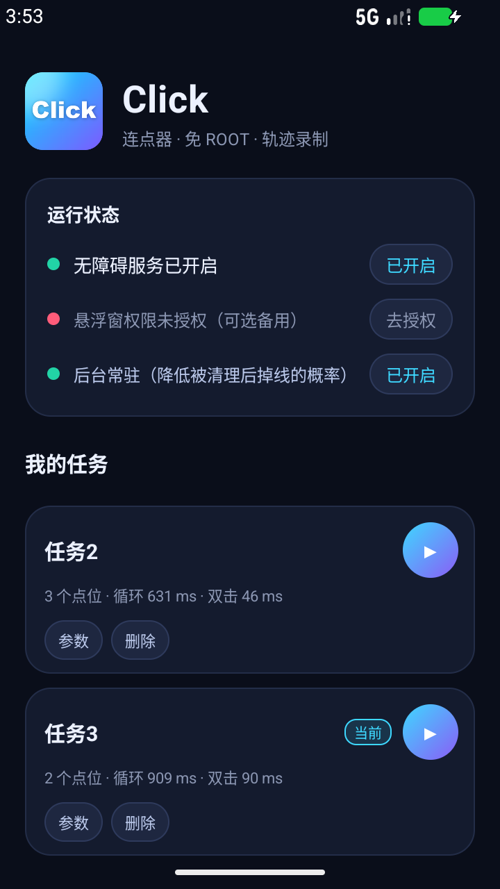
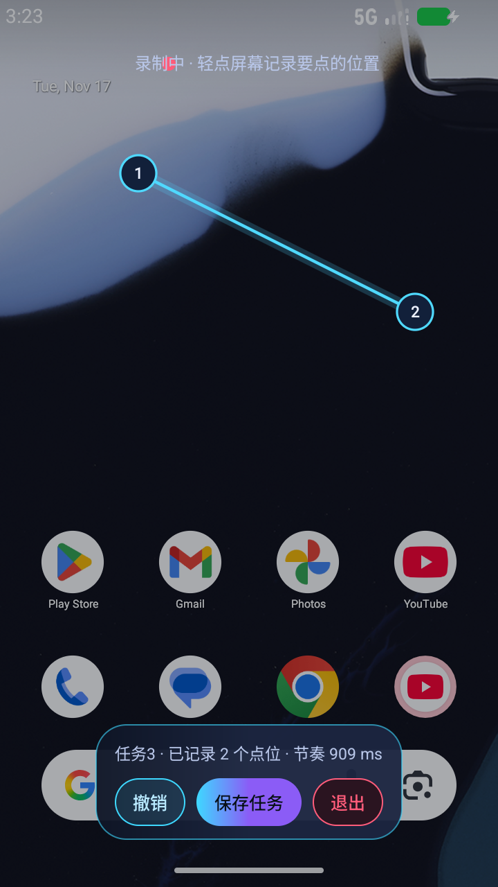
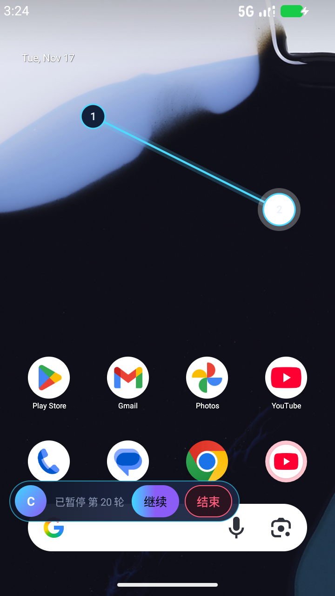

<p align="center"></p>

<h1 align="center">Click · 免 ROOT 的安卓连点器</h1>

<p align="center">录制点击轨迹与频率 · 轨迹可编辑 · 多任务保存 · 轮次 1~5 次 · 工具条常驻 · 执行时收缩为圆点避让并随时暂停</p>

<p align="center">
  <a href="Click.apk"><b>⬇ 下载 APK（v1.3.0）</b></a> &nbsp;·&nbsp;
  <a href="docs/index.html">产品官网</a> &nbsp;·&nbsp;
  <a href="__REPO__">GitHub 仓库</a>
</p>

<p align="center">
  
  
  
</p>

<p align="center"><sub>首页任务列表 &nbsp;·&nbsp; 录制轨迹与节奏 &nbsp;·&nbsp; 执行时圆点即暂停</sub></p>

---

免 ROOT、免调试模式的屏幕连点工具：录制点位与节奏，按轨迹连续双击，执行时收缩成小圆点，点一下就能暂停。

- 应用名：**Click**（包名 `com.click.autoclicker`，当前版本 **1.3.0**，首页底部也会显示）
- 安装包：[`Click.apk`](Click.apk)（已签名，可直接覆盖升级安装，Android 7.0 / API 24 及以上）
- 技术路线：`AccessibilityService` + `dispatchGesture` 派发点击，`TYPE_ACCESSIBILITY_OVERLAY` 画悬浮层 —— 因此**不需要 ROOT，也不需要开启 USB 调试**
- 产品官网：[`docs/index.html`](docs/index.html)（可直接双击打开，也可用 GitHub Pages 以 `/docs` 目录托管）

## 已实现的功能

| 需求 | 实现 |
| --- | --- |
| 连续双击屏幕 | 每个点位派发一次「双击」手势（两下点击合成一个 gesture，稳定不丢） |
| 录制点击位置与频率 | 全屏录制层按顺序记录点位，把点击节奏（间隔中位数）自动写成任务的循环间隔 |
| 录制入口在工具条上 | 工具条顺序：`图标 · 任务名 · 开始 · 录制 · 编辑`，**必须点「录制」才开始**（不会自己乱跳）；首页也保留了「＋ 录制新任务」 |
| 屏幕上显示移动轨迹 | 录制中、执行中、编辑中三处都绘制带编号的轨迹线 |
| 轨迹可编辑点位 | 拖动圆点改位置、点空白处新增点位、长按圆点删除、撤销、清空 |
| 双击频率可设置（毫秒） | 任务参数里三个毫秒值：循环停留 / 双击内间隔 / 按压时长 |
| 保存为任务、支持多个任务 | 任务存 `click_tasks.json`；首页「我的任务」就是已录制任务列表，可点卡片切换当前、▶ 执行、参数、删除 |
| 执行次数 1~5 次 + 手动停止 | 点「开始」先弹出轮次选择（1~5 或「手动停止（一直循环）」），**选完立刻开始** |
| 未执行时是工具条 | 悬浮胶囊工具条，按住图标可拖动，位置会记住 |
| 单击图标收缩 / 再点展开 | 图标单击 → 收起成只有图标的小胶囊；再单击 → 展开回完整工具条 |
| 双击图标打开首页 | 图标双击 → 打开 Click 首页；**首页在前台时工具条自动隐藏**，退出首页再回来 |
| 任务下拉切换 | 点工具条上的任务名（带 ▾）→ 弹出任务列表，点一条即切换当前任务 |
| 任务名最多四个字 | 录制、参数面板里的名称输入框都限制 4 个字，超出的会被截断 |
| 一次双击只记一个点 | 又快又近的连点（间隔 <700ms 且距离 <42dp）合并为**一个**路径点，轨迹不再密密麻麻 |
| 执行时收缩为圆点并避开执行区域 | 在四角 / 四边共 8 个候选位里挑「离所有点位最远」的位置，避开点击区域 |
| 点圆点暂停并展开工具条 | 圆点消失 → 在原位置展开「已暂停 第 N 轮 / 继续 / 结束」 |
| 图标渐变 + 应用名 | 青色→蓝→紫渐变底 + 白色 `Click` 字标，含 Android 8+ 自适应图标 |
| 首页底部署名 | 页面最底部居中显示「产品设计：FDY · 版本 x.x.x」，版本号运行时从安装包读取，永远和 APK 一致 |
| 被杀掉后不用每次重新开启无障碍 | 加了前台常驻服务（可开关），普通清理不会再杀掉进程；万一被「强制停止」，打开 App 会弹提示并一键跳到 Click 的无障碍页 |

## 关于「结束进程后要重新开无障碍」

**这是 Android 的系统行为，不是 App 的 bug。** 只要应用被「强制停止 / 结束进程」，系统就会把它从无障碍列表里摘掉（`settings get secure enabled_accessibility_services` 直接变成 `null`），而且只有 `WRITE_SECURE_SETTINGS` 这种系统级权限才能写回去 —— 普通应用（包括本 App）没有这个权限，**不能偷偷给自己重新打开**。

针对这个限制，做了三件事：

1. **后台常驻（前台服务）**：首页状态卡片第三行的「后台常驻（降低被清理后掉线的概率）」，默认开启。
   开启后进程以 `foregroundService` 优先级常驻，并显示一条不可划掉的低优先级通知「Click 连点器运行中」。
   实测：`am kill`（等同于一键清理 / 后台回收）之后进程仍然活着、无障碍绑定保持、工具条不消失。默认关闭可省电（关掉后清理软件更容易杀它）。
   - 通知需要 Android 13+ 的通知权限，首次进入会请求一次；即使拒绝也不影响功能，只是看不到这条通知。
2. **掉线时一次点击回到开关**：应用被强制停止后重新打开，会直接弹「无障碍服务已关闭」的说明框，
   点「一键去开启」直接跳到系统无障碍页并定位到 Click 这一项（用的是 `:settings:fragment_args_key`，AOSP 与多数国产 ROM 支持），再点它拨开关就好，不用自己在长长的列表里找。
3. **可选：一次 adb 授权，从此全自动**。如果你愿意在一台电脑上执行一次（不需要开「调试模式」，USB 连一下即可）：

```powershell
adb shell pm grant com.click.autoclicker android.permission.WRITE_SECURE_SETTINGS
```

   授权后 App 就有写系统设置的权限了，之后每次被结束、重新打开时会**自动把无障碍开关写回去**（首页会提示「已自动恢复无障碍服务」）。不做这一步也完全能正常用，只是仍需手动点一次。

**日常更建议这样做**，能显著减少掉线：把 Click 加入电池优化白名单 / 在最近任务里「锁定」（MIUI、鸿蒙等）；不要用「一键清理」类工具清它。

## 首次使用（约 1 分钟）

1. 安装 `Click.apk`。
2. 打开 Click，点状态卡片里的 **去开启** → 系统「无障碍」→ 已安装的服务 → **Click 连点器** → 打开。
   - 无障碍服务是唯一的必需权限，由你手动开启，随时可关。
3. 回到 Click，状态变成绿色「无障碍服务已开启」，屏幕上会出现悬浮工具条。
4. 可选：点 **去授权** 开通「显示在其他应用上层」。这是**备用通道**，正常情况不用它也能跑（悬浮层走的是无障碍浮层）。
5. 状态卡片第三行 **后台常驻** 默认已开启（会常驻一条通知）；不想要就点一下关掉，代价是被后台清理后更容易掉线。

## 工具条怎么用

```
[C]  任务2 ▾   [开始]   [录制]   [编辑]
```

- **点图标（单击）**：工具条收起成一个小胶囊（只剩图标 + 一根细竖标）；再点一下展开。
- **双击图标**：直接打开 Click 首页（首页打开期间工具条自动隐藏，返回其它界面后又出现）。
- **按住图标拖动**：整条工具条跟着走，松手后位置记下来。
- **点任务名**：弹出任务列表下拉，选哪条就把哪条设为当前任务（执行、编辑都作用在当前任务上）。
- **点「开始」**：先弹出 `1 次 / 2 次 / 3 次 / 4 次 / 5 次 / 手动停止（一直循环）`，选完**立刻开始执行**。
- **点「录制」**：立刻进入录制（任务名自动取「任务N」，≤4 字，事后可在首页改）。

## 录制一条轨迹

1. 点工具条上的 **录制**（或首页的 **＋ 录制新任务** 自己填名字）→ 回到你要操作的界面。
2. 按顺序点出需要点的位置：
   - 半透明遮罩上实时画出轨迹和编号；
   - 底部显示「已记录 N 个点位 · 节奏 xxx ms」；
   - 同一个位置很快连点两下（或小范围快速重复点）只算**一个**点位，并顺手记下双击内部间隔——所以轨迹不会一坨点。
3. 底部工具：**撤销**（删掉最后一个点）、**保存任务**、**退出**（放弃本次）。
4. 保存后工具条回到空闲态，任务名变成刚才录的这条。

## 执行

- 方式一：工具条点 **开始** → 选轮次。
- 方式二：首页任务卡片上的 ▶ → 选轮次（点完会自动退到后台，把前台让给目标应用）。
- 执行时：轨迹淡显并高亮当前点位，屏幕只剩一个呼吸小圆点，位置会自动避开点击区域。
- 点圆点 → 暂停，工具条在原位展开 **继续 / 结束**；继续回到圆点继续跑，结束则回到空闲工具条。

## 参数含义（任务卡片 → 参数）

| 参数 | 默认 | 说明 |
| --- | --- | --- |
| 任务名称 | 任务1 / 任务2… | 最多 4 个字 |
| 双击之间的停留（毫秒） | 600（录制后为记录值） | 两组双击之间等多久，越小点得越快 |
| 双击内两次点击的间隔（毫秒） | 90 | 一次「双击」里两下之间的间隔 |
| 单次按压时长（毫秒） | 60 | 每一下按住多久；太短个别应用会判为无效点击 |

一轮 = 把所有点位走完一遍。选 1~5 就是跑几轮后自动停；选「手动停止」就一直循环，直到点圆点暂停再结束。

## 用 Android Studio 打开 / 自己编译

工程是标准 Gradle 项目（AGP 8.13.2 / Gradle 8.14.3 / compileSdk 36 / minSdk 24），无任何第三方依赖。

```powershell
# 命令行编译（本机已验证可用）
$env:JAVA_HOME = "C:\Program Files\Android\Android Studio\jbr"
.\gradlew.bat assembleRelease
# 产物：app\build\outputs\apk\release\app-release.apk
```

签名配置从工程根目录的 `keystore.properties` 读取（**该文件与 keystore 不入库**，已在 `.gitignore` 中）：

```properties
storeFile=click-release.keystore
storePassword=你的口令
keyAlias=click
keyPassword=你的口令
```

把 `keystore.properties` 和 `app/click-release.keystore` 一起放到本地即可正常出签名包；没有这两个文件时仍能构建，但 release 产物是**未签名**的，需要自己 `apksigner sign` 后再安装。要上架请换成你自己的签名。

## 目录结构

```
click/
├─ Click.apk                      ← 可直接安装的成品
├─ icon-512.png                   ← 图标大图
├─ screenshots/                   ← 界面截图
├─ tools/
│  ├─ make_icon.py                ← 生成渐变启动图标（各密度 + 圆形）
│  └─ make_icon_fg.py             ← 生成自适应图标前景字标
└─ app/src/main/
   ├─ AndroidManifest.xml
   ├─ java/com/click/autoclicker/
   │  ├─ MainActivity.java           首页：状态、已录制任务列表（切换/执行/参数/删除）
   │  ├─ ClickAccessibilityService.java  无障碍服务：派发双击手势 + 屏幕尺寸
   │  ├─ KeepAliveService.java         前台常驻服务：降低被清理后掉线的概率
   │  ├─ OverlayManager.java         悬浮层状态机：工具条（含收缩/下拉/轮次）/ 圆点 / 暂停 / 录制 / 编辑
   │  ├─ Runner.java                 执行引擎：按点位与节奏循环双击
   │  ├─ TrajectoryView.java         轨迹绘制与点位编辑（拖动/新增/长按删除）
   │  ├─ RecordView.java             录制层：记录位置与节奏（快速重复点合并）
   │  ├─ DotView.java                执行中的呼吸圆点
   │  ├─ Task.java / TaskStore.java  任务模型与本地持久化（含 ≤4 字命名）
   │  └─ U.java                      颜色与圆角等小工具
   └─ res/                          布局、主题、无障碍配置、图标
```

## 已知边界

- 录制时遮罩会吃掉触摸，所以是「在遮罩上点位」，不是边操作边录（这是免 ROOT 方案的通性）。
- 坐标按屏幕绝对像素记录，**换设备或改分辨率后建议重新录制**；执行过程中不要旋转屏幕。
- 部分定制系统（MIUI / 鸿蒙等）可能在无障碍服务被系统回收后需要重新打开；把 Click 加入电池优化白名单会更稳。
- 应用被「强制停止 / 结束进程」后，系统会清空无障碍开关（Android 安全策略），必须再手动开一次；本 App 已把这步简化成一次点击，详见上面「关于结束进程后要重新开无障碍」。
- 无障碍服务无法在被系统强制停止的应用进程内工作，若工具条消失，重进一次 Click 即可。
- 下拉 / 轮次菜单是悬浮小窗，如果机型上弹不出来，请开一下「显示在其他应用上层」（备用通道）。
